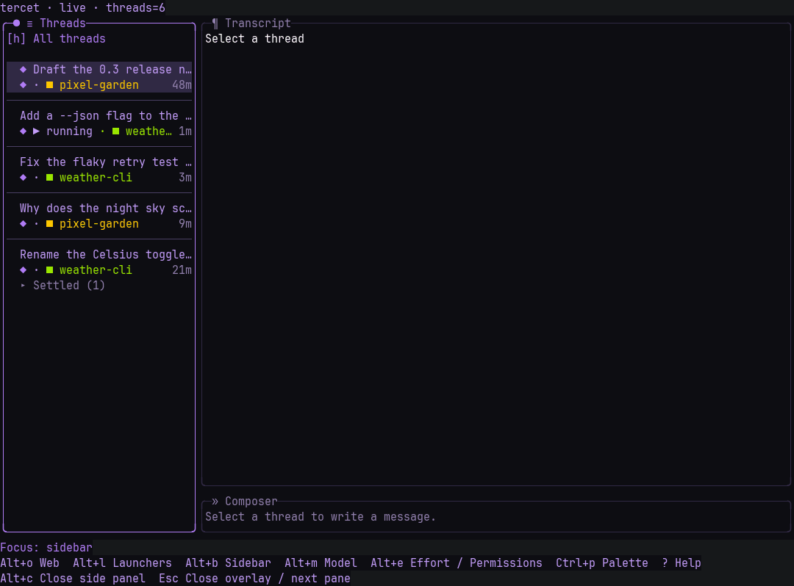

# tercet: a terminal client (TUI) for T3 Code

tercet is a terminal UI for [T3 Code](https://github.com/pingdotgg/t3code). Your threads,
transcripts and composer run in the terminal, next to the web app, on the same server. It works
over SSH and inside tmux, and needs no window.



- **The web app's behavior, in a terminal.** Same thread list, shelves and models, live
  streaming, a composer with `@file`, `/skill` and `:emoji`, diffs and the files panel. Mouse
  and keyboard (vim keys in the transcript) both work.
- **Images in any terminal.** Kitty graphics where the terminal has them, Sixel, colored blocks
  everywhere else, and a plain placeholder when you ask for one, rather than an empty box.
- **Your machine stays yours.** Shell, editor, clipboard targets, openers and your own commands
  live in one settings file. Anything you don't set up has no button, and `tercet doctor`
  tells you what works on your setup.

```bash
bun install -g github:Steven-ODell/tercet
```

You need [Bun](https://bun.com) (tested with 1.4.0) and a T3 Code server on the same machine.
tercet is built and tested against T3 0.1.8; other versions start under a warning banner. No Bun yet? `curl -fsSL https://bun.com/install | bash`, or
use the install script, which checks for Bun first and then runs the line above:

```bash
curl -fsSL https://raw.githubusercontent.com/Steven-ODell/tercet/main/install.sh | sh
```

Updating, removing and running from a checkout: [docs/install.md](docs/install.md).

Then:

```bash
tercet doctor   # what tercet found: server, token, terminal, images, clipboard
tercet          # open it
```

## Run it on the machine that has your T3 server

tercet talks to `http://127.0.0.1:3773` by default, the address `t3` serves on. On first start
it asks the local `t3` command for a session token (`t3 auth session issue`) and keeps it in
`~/.config/tercet/token`, so the `t3` command must be on PATH.

tercet works with the projects and agents your server already has. Add a project in the web
app or with `t3 project add <folder>`, and set up at least one provider (Codex, Claude and so
on) there too.

To use it from another computer, SSH to the server machine and run `tercet` there. Use whatever
you already use to reach that machine; tercet adds no tunnels or pairing. Copying text still
reaches the computer you type on through OSC 52 if your terminal allows it. For a server
elsewhere, set an `https://` `server.url` and a `server.tokenFile` you issued yourself; tercet
will not send this machine's token anywhere but loopback.

## Terminals

| Terminal                | Images                              | Tested                                      |
| ----------------------- | ----------------------------------- | ------------------------------------------- |
| Ghostty on Linux        | Kitty graphics                      | yes, daily use                              |
| kitty                   | Kitty graphics, expected            | untested                                    |
| WezTerm                 | Kitty graphics, expected            | untested                                    |
| foot                    | Sixel, expected                     | untested                                    |
| iTerm2                  | Sixel if it reports it, else blocks | untested                                    |
| Alacritty               | colored blocks, expected            | untested                                    |
| macOS Terminal          | colored blocks, expected            | untested                                    |
| tmux 3.8 inside Ghostty | Kitty graphics through passthrough  | yes, `tercet doctor` and the acceptance run |
| zellij, screen          | colored blocks, expected            | untested                                    |

macOS is tested in CI only (typecheck, unit tests, the bundle). Windows is not supported.
"Expected" follows from how tercet detects images: it asks the terminal, and uses whatever the
terminal answers. Run `tercet doctor` in yours and see the `images` line. Reports of other
terminals are welcome.

## Settings

T3's own settings (projects, providers, models, permissions) come from the T3 server, so there
is nothing to copy over. The settings file holds only what belongs to tercet: keys, look,
commands and images. It is one JSON-with-comments file, `~/.config/tercet/settings.json` (or
under `$XDG_CONFIG_HOME`), and it does not exist at first. Create it yourself:

```sh
mkdir -p ~/.config/tercet
$EDITOR ~/.config/tercet/settings.json
```

Every key is optional and a missing key means the default. A typo stops startup with the line and
key named. tercet reads the file at startup, so restart it after editing, and run `tercet doctor`
to check the file (the `settings` line should say `ok`). For example:

```jsonc
{
  "defaults": { "provider": "codex", "model": "gpt-5.5", "sendShortcut": "enter" },
  "theme": { "preset": "cyberdream" }, // or "light", or "ansi" for 16-color terminals
  "icons": "unicode", // "nerd" with a Nerd Font, "ascii" for no glyphs at all
  "keys": { "palette": "Ctrl+k", "focusUp": "Alt+k" },
  "launchers": { "terminal": ["foot", "-D", "{cwd}"], "editor": "nvim" },
  "commands": {
    // A [run] button on shell code blocks: runs the block in a new foot window, in the
    // thread's folder, and leaves a shell open there.
    "run": ["foot", "-D", "{cwd}", "bash", "-c", "eval \"$1\"; exec bash", "run", "{text}"],
  },
}
```

Commands run without a shell, and thread text always stays one argument. Every key, the command
templates and their placeholders: [docs/settings.md](docs/settings.md). Images and video:
[docs/media.md](docs/media.md).

## Spell check

Misspelled words in the composer are underlined in red. Right-click one (or press `Alt+s`) for a
menu of corrections, `Add to dictionary` and `Ignore`. The English dictionary is built in; code,
paths, URLs and mentions are skipped. Turn it off with `"spell": { "enabled": false }`; details
in [docs/settings.md](docs/settings.md#spell-check).

## Dictation

Press `Alt+v` or click `[mic]`, speak, then press again to transcribe into the editable draft.
Text stays in the thread where recording began and is never sent automatically. Press mic
again during transcription to cancel; Esc in the composer cancels built-in recording too.

Install a local recorder (see [capture dependencies](docs/install.md#dictation-capture)) and
configure your T3 server's speech model in its web app under **Settings → Voice**. tercet uses
that server model over authenticated HTTP, without a separate transcription app. Model setup
and downloads are explicit; tercet never performs them for you. `commands.dictation` remains
an override for external integrations. SSH does not forward your microphone.

## Keys

`?` shows the cheat sheet in the app and `tercet keys` prints it, both built from your current
bindings. The defaults:

| Key                                   | Does                                             |
| ------------------------------------- | ------------------------------------------------ |
| `Ctrl+p`                              | palette: jump to a thread or run a thread action |
| `Ctrl+n`                              | new thread                                       |
| `Ctrl+/`                              | search threads                                   |
| `Alt+m`, `Alt+e`                      | model, effort and permissions                    |
| `Alt+f`, `Alt+d`                      | files, diff                                      |
| `Alt+j`                               | the thread's terminal                            |
| `Alt+h`, `Ctrl+j`, `Ctrl+k`, `Ctrl+l` | move between panes                               |
| `Esc`                                 | close an overlay, or go to the next pane         |
| `h j k l w b e`, `gg G`               | move in the transcript                           |
| `v V`, `y yy`                         | select, yank                                     |
| `i a o`                               | write in the composer                            |
| `Y`, `O`                              | copy or open the block, link or selection        |
| `Ctrl+c` twice                        | quit                                             |

To rebind, name the command in the `keys` setting. `tercet keys` prints each command's name in
its last column (`palette`, `focusUp`, `newThread` and so on), and `"none"` unbinds one:

```jsonc
"keys": { "palette": "Ctrl+k", "newThread": "Ctrl+t", "search": "none" }
```

Alt keys need your terminal to send Esc for Alt (on macOS: "Use Option as Meta key" or
similar). More on [keys that depend on the
terminal](docs/settings.md#keys-that-depend-on-the-terminal).

## Troubleshooting

- **If you use tmux.** tercet runs fine in it, but images and the Ctrl+Shift keys need two
  lines in `~/.tmux.conf`, then a tmux restart:

  ```
  set -g allow-passthrough on
  set -s extended-keys on
  ```

  Without passthrough tercet draws images as colored blocks, says so on the status bar once,
  and `tercet doctor` shows the setting. Other multiplexers (zellij, screen) are untested.
- **Boxes or question marks instead of icons.** `"icons": "nerd"` needs a Nerd Font in the
  terminal that draws the screen (over SSH, the one you type on). Use `"unicode"`, the default,
  or `"ascii"`.
- **A terminal that claims more than it can do.** Some terminals answer the image queries and
  then draw nothing, or draw garbage. Set `"media": { "protocol": "blocks" }`, or `"none"` for
  placeholders.
- **"Built for T3 0.1.8, you're on ..." banner.** Your T3 server is a version tercet was not
  tested on. It still works, but screens or actions T3 added since may be missing or broken.
  `Alt+x` or a click hides the banner for the session. Update tercet when a release for your T3
  version is out.
- **"Incompatible server protocol".** The server speaks another orchestration protocol, so
  tercet stops before it connects. Update tercet (or T3). `tercet --ignore-version`, or
  `"ignoreVersion": true` under `server` in the settings file, tries anyway at your own risk.
- **Can't connect.** `tercet doctor` checks the server and token. A server on another port or
  host needs `server.url`; one started with another `--base-dir` needs `server.baseDir`.

## Known limits

- Windows is not supported.
- Over SSH tercet can write your local clipboard (OSC 52) but not read it, so paste from the
  computer you type on goes through your terminal's own paste. A `commands.paste` template can
  fetch it another way.
- T3 Code's RPC is not a public, stable API. tercet pins the T3 versions it was tested with and
  says so plainly when the server is newer; expect an update after a T3 release.
- No plan-mode UI. Approvals are minimal. Browser and device views open the web app.

## Credits

tercet is built on [OpenTUI](https://github.com/anomalyco/opentui) and React, and vendors part of
[T3 Code](https://github.com/pingdotgg/t3code) (MIT, T3 Tools Inc.) to speak its protocol; see
[THIRD_PARTY.md](THIRD_PARTY.md). Contributing: [CONTRIBUTING.md](CONTRIBUTING.md).

tercet is an unofficial, community client. It is not made by or affiliated with T3 Tools Inc.

MIT License, Steven O'Dell.
