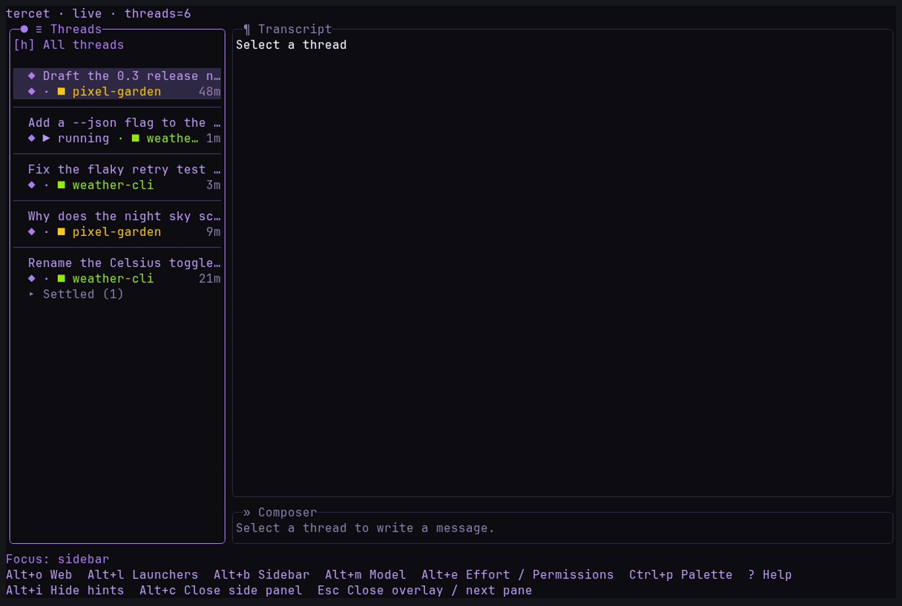

# tercet: a terminal client (TUI) for T3 Code

tercet is a terminal UI for [T3 Code](https://github.com/pingdotgg/t3code). Your threads,
transcripts and composer run in the terminal, next to the web app, on the same server. It works
over SSH and inside tmux, and needs no window.



- **The web app's behavior, in a terminal.** Same thread list, shelves and models, live
  streaming, a composer with `@file`, `/skill` and `:emoji`, diffs and the files panel. Mouse
  and keyboard (vim keys in the transcript) both work.
- **Images in any terminal.** Kitty graphics where the terminal has them, Sixel, colored blocks
  everywhere else, and a plain placeholder when you ask for one, rather than an empty box.
- **Your machine stays yours.** Shell, editor, clipboard targets, openers and your own commands
  live in one settings file. Anything you don't set up has no button, and `tercet doctor`
  tells you what works on your setup.

Pick whichever install suits you. All three give you the same `tercet` command:

```bash
# 1. Prebuilt binary: no Bun, checksum-verified, goes in ~/.local/bin
curl -fsSL https://raw.githubusercontent.com/Steven-ODell/tercet/main/install.sh | sh

# 2. With Bun 1.4.0 or newer
bun install -g github:Steven-ODell/tercet

# 3. From a clone, built by hand
git clone https://github.com/Steven-ODell/tercet && cd tercet && bun install && bun run build && bun link
```

Windows (PowerShell): `irm https://raw.githubusercontent.com/Steven-ODell/tercet/main/install.ps1 | iex`.
Binaries for Linux and macOS (x64 and arm64) and Windows (x64) are also on the
[releases page](https://github.com/Steven-ODell/tercet/releases), each release listing the T3
Code versions it was tested against. You need a T3 Code server on the same machine; tercet is built
and tested against T3 0.1.9, and other versions start under a warning banner. The Bun and clone
routes need [Bun](https://bun.com) (tested with 1.4.0); the install script's `--bun` flag checks
for it first.

Then:

```bash
tercet doctor   # what tercet found: server, token, terminal, images, clipboard
tercet          # open it
```

Updating (`tercet upgrade` for the binary), removing and every install option: [docs/install.md](docs/install.md).

## Run it on the machine that has your T3 server

tercet talks to `http://127.0.0.1:3773` by default, the address `t3` serves on. On first start
it asks the local `t3` command for a session token (`t3 auth session issue`) and keeps it in
`~/.config/tercet/token`, so tercet must find the `t3` command. It checks PATH and the usual
install folders; if it still cannot (common on Windows), set `server.t3Command` to the full path
of `t3` (`t3.cmd` on Windows) in your settings file, or issue a token yourself with
`t3 auth session issue` and set `server.tokenFile`. `tercet doctor` shows which one applies.

tercet works with the projects and agents your server already has. Add a project in the web
app or with `t3 project add <folder>`, and set up at least one provider (Codex, Claude and so
on) there too.

To use it from another computer, SSH to the server machine and run `tercet` there. Use whatever
you already use to reach that machine; tercet adds no tunnels or pairing. Copying text still
reaches the computer you type on through OSC 52 if your terminal allows it. For a server
elsewhere, set an `https://` `server.url` and a `server.tokenFile` you issued yourself; tercet
will not send this machine's token anywhere but loopback.

## Terminals

| Terminal                | Images                              | Tested                                      |
| ----------------------- | ----------------------------------- | ------------------------------------------- |
| Ghostty on Linux        | Kitty graphics                      | yes, daily use                              |
| kitty                   | Kitty graphics, expected            | untested                                    |
| WezTerm                 | Kitty graphics, expected            | untested                                    |
| foot                    | Sixel, expected                     | untested                                    |
| iTerm2                  | Sixel if it reports it, else blocks | untested                                    |
| Alacritty               | colored blocks, expected            | untested                                    |
| macOS Terminal          | colored blocks, expected            | untested                                    |
| tmux 3.8 inside Ghostty | Kitty graphics through passthrough  | yes, `tercet doctor` and the acceptance run |
| zellij, screen          | colored blocks, expected            | untested                                    |

macOS is tested in CI only (typecheck, unit tests, the bundle). Native Windows support is
experimental; use Windows Terminal and Bun 1.4.0 or newer. See [Windows setup and test
coverage](docs/windows.md).
"Expected" follows from how tercet detects images: it asks the terminal, and uses whatever the
terminal answers. Run `tercet doctor` in yours and see the `images` line. Reports of other
terminals are welcome.

## From the command line

The same server and token, without the screen:

```bash
tercet list                  # threads as a table: id, state, project, title
tercet list --json           # the same as JSON, for scripts (add --all for archived ones)
tercet attach 3f9a1c2e       # one thread full screen: its id, short id or part of its title
tercet tmux                  # a tmux window per active thread, each running `tercet attach`
tercet tmux --watch          # keep going: a window opens when a thread starts working
tercet upgrade               # replace the binary with the newest release (--check: only look)
```

`state` is `running`, `waiting` (stopped on an approval or question), `failed`, `limited` or
`idle`. `list --json` gives `id`, `shortId`, `title`, `project`, `projectId`, `state`, `pinned`,
`archived`, `provider`, `model`, `branch` and `updatedAt`, so
`tercet list --json | jq -r '.[] | select(.state == "waiting") | .title'` finds what needs you.

`tercet tmux` puts the active threads (running or waiting) in a session called `tercet`
(`--session NAME` to change it, `--socket NAME` for `tmux -L NAME`) and exits; attach with
`tmux attach -t tercet`. With `--watch` it stays running, opens a window for each thread as it
starts working, and closes a window once its thread has been idle for 30 seconds and nobody is
looking at it (`--keep` never closes). Close a window yourself while its thread still works and
it stays closed until the thread settles. Both commands take the connection options of
`tercet --help`, and `tmux` passes them on to each window.

Inside the app, Enter while a turn runs queues your message after it, Alt+Enter steers it into
the running turn, and `Ctrl+x` drops a queued one.

## Read responses aloud

Click **[read]** below an assistant response to hear it through Kokoro. It plays on the machine you
click from, including over SSH. A spinner beside it means the speech is being made, a play icon
means it is playing. **[stop reading]** (or clicking **[read]** again) cancels it. Voice and speed
are configurable in settings.

Read aloud needs a one-time setup, and tercet never does it for you. Run:

```sh
tercet readback setup
```

It shows what it will do and asks y/N first. It creates a Python venv, installs `kokoro-onnx` and
numpy there, and downloads the two Kokoro model files (about 354 MB, checked against SHA-256).
`--yes` skips the question, `--dry-run` prints the plan and changes nothing. `tercet readback status`
says whether it is ready and what is missing. Until then, clicking **[read]** shows "Read aloud is
not set up. Run `tercet readback setup`." and `tercet doctor` has a `read aloud` row with the same
hint. You also need an audio player (mpv, ffplay or afplay). Details, other locations and the
Kokoro-FastAPI alternative: [readback setup](docs/settings.md#response-readback-kokoro).

## Settings

T3's own settings (projects, providers, models, permissions) come from the T3 server, so there
is nothing to copy over. The settings file holds only what belongs to tercet: keys, look,
commands and images. It is one JSON-with-comments file, `~/.config/tercet/settings.json` (or
under `$XDG_CONFIG_HOME`), and it does not exist at first. Create it yourself:

```sh
mkdir -p ~/.config/tercet
$EDITOR ~/.config/tercet/settings.json
```

Every key is optional and a missing key means the default. A typo stops startup with the line and
key named. tercet reads the file at startup, so restart it after editing, and run `tercet doctor`
to check the file (the `settings` line should say `ok`). For example:

```jsonc
{
  "defaults": { "provider": "codex", "model": "gpt-5.5", "sendShortcut": "enter" },
  "theme": { "preset": "cyberdream" }, // 15 presets (nord, gruvbox, catppuccin-mocha...), "ansi", or "auto"
  "icons": "unicode", // "nerd" with a Nerd Font, "ascii" for no glyphs at all
  "keys": { "palette": "Ctrl+k", "focusUp": "Alt+k" },
  "launchers": { "terminal": ["foot", "-D", "{cwd}"], "editor": "nvim" },
  "commands": {
    // A [run] button on shell code blocks: runs the block in a new foot window, in the
    // thread's folder, and leaves a shell open there.
    "run": ["foot", "-D", "{cwd}", "bash", "-c", "eval \"$1\"; exec bash", "run", "{text}"],
  },
}
```

To have every message you send start with where you typed it (useful when you type from more
than one machine), set `messageTag`. It is off unless `local` or `ssh` is set. `local` is used when
you type on the machine tercet runs on; `ssh` when you type over SSH, with `{client}` replaced by
the client's name from `clients` (else its address). A message that already starts with `<from `
is not tagged again, and queued edits are left as they are:

```jsonc
"messageTag": {
  "local": "<from PC>",
  "ssh": "<from {client} SSH to PC>",
  "clients": { "100.97.33.14": "laptop" },
}
```

Commands run without a shell, and thread text always stays one argument. Every key, the command
templates and their placeholders: [docs/settings.md](docs/settings.md). Images and video:
[docs/media.md](docs/media.md).

## Spell check

Misspelled words in the composer are underlined in red. Right-click one (or press `Alt+s`) for a
menu of corrections, `Add to dictionary` and `Ignore`. The English dictionary is built in; code,
paths, URLs and mentions are skipped. Turn it off with `"spell": { "enabled": false }`; details
in [docs/settings.md](docs/settings.md#spell-check).

## Dictation

Press `Alt+v` or click `[mic]`, speak, then press again to transcribe into the editable draft.
Text stays in the thread where recording began and is never sent automatically. Press mic
again during transcription to cancel; Esc in the composer cancels built-in recording too.

Install a local recorder (see [capture dependencies](docs/install.md#dictation-capture)) and
configure your T3 server's speech model in its web app under **Settings → Voice**. tercet uses
that server model over authenticated HTTP, without a separate transcription app. Model setup
and downloads are explicit; tercet never performs them for you. `commands.dictation` remains
an override for external integrations. SSH does not forward your microphone.

## Keys

`?` shows the cheat sheet in the app and `tercet keys` prints it, both built from your current
bindings. The defaults:

| Key                                   | Does                                             |
| ------------------------------------- | ------------------------------------------------ |
| `Ctrl+p`                              | palette: jump to a thread or run a thread action |
| `Ctrl+n`                              | new thread                                       |
| `Ctrl+/`                              | search threads                                   |
| `Alt+m`, `Alt+e`                      | model, effort and permissions                    |
| `Alt+f`, `Alt+d`                      | files, diff                                      |
| `Alt+j`                               | the thread's terminal                            |
| `Alt+h`, `Ctrl+j`, `Ctrl+k`, `Ctrl+l` | move between panes                               |
| `Esc`                                 | close an overlay, or go to the next pane         |
| `h j k l w b e`, `gg G`               | move in the transcript                           |
| `/`, then `n` or `N`                     | find literal text in the loaded transcript, next or previous match |
| `v V`, `y yy`                         | select, yank                                     |
| `i a o`                               | write in the composer                            |
| `Y`, `O`                              | copy or open the block, link or selection        |
| `Ctrl+c` with selected text           | copy selection                                   |
| `Ctrl+c` twice, without selection     | quit                                             |

Click the Context meter or press `Alt+u` to see provider-reported usage and a breakdown of loaded transcript text. The breakdown estimates tokens for messages, visible reasoning, and tool arguments and results. It lists the four largest tools by loaded text, with call counts.

Files and Diff temporarily hide the thread list when keeping it open would leave fewer than 60 columns for the transcript. Closing the panel restores your previous layout.

Drag to highlight transcript text, then right-click **Copy**; completed drags also copy
immediately. The menu preserves the selection and holds transcript scrolling while open.
Vim visual selections also offer right-click Copy; `y` still yanks them. In the composer,
right-click for Copy, Cut, Paste, Select all, Undo/Redo and spelling suggestions. Hold Shift
to use your terminal's native mouse selection instead. A focused embedded terminal keeps
Ctrl+C as an interrupt.

To rebind, name the command in the `keys` setting. `tercet keys` prints each command's name in
its last column (`palette`, `focusUp`, `newThread` and so on), and `"none"` unbinds one:

```jsonc
"keys": { "palette": "Ctrl+k", "newThread": "Ctrl+t", "search": "none" }
```

Alt keys need your terminal to send Esc for Alt (on macOS: "Use Option as Meta key" or
similar). More on [keys that depend on the
terminal](docs/settings.md#keys-that-depend-on-the-terminal).

## Troubleshooting

- **If you use tmux.** tercet runs fine in it, but images and the Ctrl+Shift keys need two
  lines in `~/.tmux.conf`, then a tmux restart:

  ```
  set -g allow-passthrough on
  set -s extended-keys on
  ```

  Without passthrough tercet draws images as colored blocks, says so on the status bar once,
  and `tercet doctor` shows the setting. Other multiplexers (zellij, screen) are untested.
- **Boxes or question marks instead of icons.** `"icons": "nerd"` needs a Nerd Font in the
  terminal that draws the screen (over SSH, the one you type on). Use `"unicode"`, the default,
  or `"ascii"`.
- **A terminal that claims more than it can do.** Some terminals answer the image queries and
  then draw nothing, or draw garbage. Set `"media": { "protocol": "blocks" }`, or `"none"` for
  placeholders.
- **"Built for T3 0.1.9, you're on ..." banner.** Your T3 server is a version tercet was not
  tested on. It still works, but screens or actions T3 added since may be missing or broken.
  `Alt+x` or a click hides the banner for the session; `"hideWarning": true` under `server` in
  the settings file never draws it. Update tercet when a release for your T3 version is out.
- **"Incompatible server protocol".** The server speaks another orchestration protocol, so
  tercet stops before it connects. Update tercet (or T3). `tercet --ignore-version`, or
  `"ignoreVersion": true` under `server` in the settings file, tries anyway at your own risk.
- **Can't connect.** `tercet doctor` checks the server and token. A server on another port or
  host needs `server.url`; one started with another `--base-dir` needs `server.baseDir`.

## Known limits

- Native Windows support is experimental pending a passing Windows CI run and a hands-on terminal trial.
- Over SSH tercet can write your local clipboard (OSC 52) but not read it, so paste from the
  computer you type on goes through your terminal's own paste. A `commands.paste` template can
  fetch it another way.
- T3 Code's RPC is not a public, stable API. tercet pins the T3 versions it was tested with and
  says so plainly when the server is newer; expect an update after a T3 release.
- No plan-mode UI. Approvals are minimal. Browser and device views open the web app.

## Credits

tercet is built on [OpenTUI](https://github.com/anomalyco/opentui) and React, and vendors part of
[T3 Code](https://github.com/pingdotgg/t3code) (MIT, T3 Tools Inc.) to speak its protocol; see
[THIRD_PARTY.md](THIRD_PARTY.md). Contributing: [CONTRIBUTING.md](CONTRIBUTING.md).

tercet is an unofficial, community client. It is not made by or affiliated with T3 Tools Inc.

MIT License, Steven O'Dell.

## Edit files inside tercet

Open Files with `Alt+f`, select a file with Enter, then press `e` or click **Edit here**.
This starts Neovim in a dedicated embedded terminal (`nvim --clean`, falling back to `vi`).
Press `i` to insert, Esc to return to normal mode, then `:w` Enter to save or `:wq` Enter
to save and quit. After exit, Enter returns to Files with a fresh preview.

`Alt+h` moves back to chat; `Alt+c` hides the editor; `Alt+r` resumes it. Hidden editors keep
running, even across thread changes, and show their original workspace at the top. One editor
runs at a time: opening another file while it runs resumes that session. Use the editor's
`:edit path` or quit it before opening a different file. Ordinary keys, Esc and Ctrl combinations
belong to the focused editor. The mouse operates Tercet's buttons and pane focus; edit text
with the keyboard.

`o` / **External editor** uses your configured launcher, then VISUAL/EDITOR. Terminal editors
open in a separate terminal window by default; `launchers.editorMode: "tmux"` opts into tmux
sessions. GUI editors such as VS Code launch directly; settings can link an absolute executable
path when it is outside PATH. No editor set means a setup prompt. See [settings](docs/settings.md).
For a different embedded terminal editor, set `commands.embeddedEditor` as described in
[settings](docs/settings.md). Read-only mode blocks editor launch. Run Tercet on the server
machine (SSH works); direct connections to remote servers cannot use the embedded editor.
